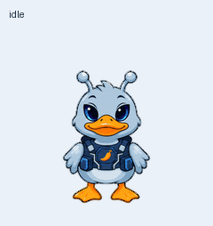

# Quark

Quark is a silver-blue alien developer duck with glossy violet-black almond eyes, cyan highlights, paired antennae, a navy sci-fi vest, and an orange chili badge.

This backup contains the final alien-eye revision created on 2026-10-09.

- [Sprite sheet](spritesheet.png): exact validated transparent v2 PNG, 1536 × 2288 pixels, eight columns and eleven rows with 192 × 208 cells.
- [Character artwork](artwork.png): original-resolution identity reference with a magenta production background.
- [MP4 preview](previews/all-states.mp4), [gaze loop](previews/look-loop.gif), and [idle-to-jump transition](previews/idle-jump-idle.gif).
- `previews/`: all nine state GIFs and four labeled stills.
- `pet.json`: stable pet ID, description, revision, and layout details.
- `validation/`: sprite, quality, and independent direction review reports.
- `checksums.json`: file integrity records.

The first nine rows represent idle, running right, running left, waving, jumping, failed, waiting, active work, and review. The final two rows hold sixteen clockwise gaze directions, starting at up and advancing in 22.5-degree steps. Required frames per row: 6, 8, 8, 4, 5, 8, 6, 6, 6, 8, 8. Unused cells are transparent.

The artwork was created using OpenAI's built-in image generation and assembled and checked with the Pets skill's bundled scripts. Sprite validation and quality gates passed; three independent blind direction reviewers agreed on the gaze directions. The continuity report's top-of-head alpha warning was inspected and corresponds to exterior space between the attached antennae.

The original registered pet ID is recorded for reference. These files back up the artwork; placing them in another repository does not automatically install or activate a pet. The PNG can be reused through the Pets creation or update workflow.
